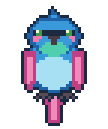

# 🐦 Deskbird

> A cosy 8-bit desktop pixel bird that follows your cursor around the screen and displays real-time speech notes sent from friends via a clean web link.



```
       .-''''-.
     .'  _     '.
    /   (o)      \   "Hi! Tell your friend this code: ABCD-2345"
   |      .-.     |   /
   |     (   )    |.-'
    \     `-'    /
     '.  __   .'
       `''''`
```

---

## ⚡ 30-Second Quick Start

### For User 1 (The Bird Owner):
Run one command in your terminal:
```powershell
npx deskbird
```
That's it! The bird appears on your desktop, flaps its wings beside your mouse, and introduces itself with a speech bubble showing your unique room code (e.g. `ABCD-2345`). Right-click the bird's system tray icon and click **"Copy Message Link"** to share with a friend.

### For User 2 (The Note Sender):
Open the link your friend shared (or go to `https://deskbird.vercel.app/#/ABCD2345`):
1. Type a friendly note (up to 120 characters).
2. Press **Enter** (or click **SEND MESSAGE**).
3. The note immediately appears as an 8-bit RPG speech bubble next to the bird on your friend's screen!

---

## ⚠️ Requirements & Honest First-Run Limits

- **Node.js**: Requires **Node.js (Current or LTS, >= 20.0.0)** installed on your machine.
- **Initial Download**: The very first time you run `npx deskbird`, npm downloads the Electron runtime binary (~100 MB). This typically takes 30 to 60 seconds depending on your connection. Subsequent launches start instantly.
- **Corporate Proxies**: If your network restricts direct downloads from GitHub Releases, set the mirror environment variable before running:
  ```powershell
  $env:ELECTRON_MIRROR="https://npmmirror.com/mirrors/electron/"
  npx deskbird
  ```

---

## 🕹️ Controls & Interactions

| Action | How to Trigger | What Happens |
|---|---|---|
| **Hover Follow** | Default state | The bird stays beside your cursor (+72 DIP), hovering with a gentle figure-8 drift and flapping wings. **100% click-through**—it never steals clicks or window focus! |
| **Edge Flip** | Move near right edge | Smoothly flips from the right to the left side of your pointer so it never overflows off-screen. |
| **Perch on Branch** | Click the wooden perch bar | The bird flies along an upward curved arc to the branch in the top-right corner, lands with a squash animation, and rests. |
| **Take Off** | Click the perched bird | Performs a quick hop and flutter, resuming mouse following. |
| **Perched Life** | Sitting on branch | Sits calmly, blinks its eyes every 3–6 seconds, and occasionally scratches its head with its foot every 6–15 seconds. |
| **Dismiss Bubble** | Click the speech bubble | Instantly dismisses the note so you can read the next one in the queue. |
| **System Tray** | Right-click tray icon | Access controls: Copy Link, Show Code, Perch/Release, Mute/Unmute audio, Start on Login, Pause/Resume, and Quit. |

---

## 🧩 How It Works

```
[ Sender Web App ] ──────── HTTPS / WSS ───────► [ Render Relay Server ]
 (Vercel static)                                 (Express + Socket.IO v4)
        ▲                                                    │
        │                                                    │ WSS (Forward)
        └────── "seen by bird ✓✓" (Receipt) ◄────────────────┤
                                                             ▼
                                                    [ Desktop Bird App ]
                                                      (Electron Overlay)
```

1. **Deterministic Rooms**: On first launch, the bird generates a 32-byte secret and deterministically derives an 8-character Base32 room code ($$\text{roomId} = \text{Base32}(\text{SHA-256}(\text{secret}))[:8]$$).
2. **Stateless Relay**: When the bird connects, the server verifies the secret against the room ID. Senders only ever know the public code.
3. **Resilient Offline Delivery**: If your bird is closed or your computer is asleep, up to 20 messages are safely buffered in server memory (24h TTL) and delivered the moment your bird reconnects.

---

## 🎨 Visual Identity & Palette

Deskbird rejects generic AI aesthetic tropes (no purple gradients, no neon cyan, no glassmorphism, no blurry shadows). Instead, it embraces a warm, retro handheld gaming aesthetic inspired by EarthBound and Pokémon Gen 1:

- **14 Canonical Colors**: Earthy rust body (`#b8663a`), cream belly (`#f0dfb6`), mustard beak (`#d9a21b`), and dark walnut perch (`#6e4a2e`).
- **Tack-Sharp Pixel Art**: Integer scaling (4x scale = 96 DIP) with `image-rendering: pixelated;`.
- **Typewriter Audio**: Optional classic 8-bit character blips synthesized via the Web Audio API.

---

## 🧪 Local Testing & Verification

Test the entire application end-to-end on one machine before deploying:

```powershell
# Start server, web app, and bird companion together in local test mode:
npm run dev:all

# Run the automated unit and integration test suite:
npm test

# Run code linter:
npm run lint

# Launch standalone demo mode (no servers needed):
npm run demo

# Inspect pixel art frames and animated loops in your browser:
npm run sprites:preview
```

For the human testing procedure, follow [`docs/MANUAL_TESTING.md`](docs/MANUAL_TESTING.md).

---

## 📚 Complete Documentation Index

- [Architecture & State Machine](docs/ARCHITECTURE.md)
- [Protocol Specification & Events](docs/PROTOCOL.md)
- [Local Single-PC Testing Guide](docs/LOCAL_TESTING.md)
- [Human Manual Testing Checklist](docs/MANUAL_TESTING.md)
- [Render Server Deployment Blueprint](docs/DEPLOY_RENDER.md)
- [Vercel Web App Deployment Guide](docs/DEPLOY_VERCEL.md)
- [Publishing to npm Registry](docs/PUBLISH_NPM.md)
- [Production Release Checklist](docs/RELEASE_CHECKLIST.md)
- [Troubleshooting & FAQ](docs/TROUBLESHOOTING.md)
- [Art & Design Direction](docs/DESIGN.md)
- [Security & Privacy Statement](docs/SECURITY.md)
- [Decisions & Version Log](docs/DECISIONS.md)

---

## 📜 License & Credits

- Created with ❤️ by [rish170](https://github.com/rish170).
- Released under the [MIT License](LICENSE).
